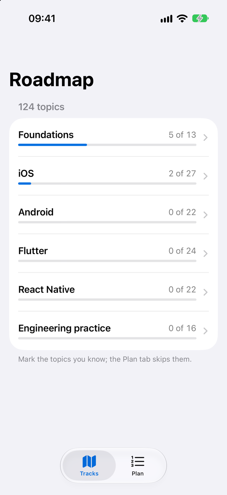
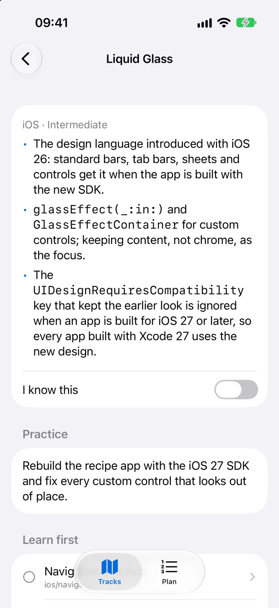
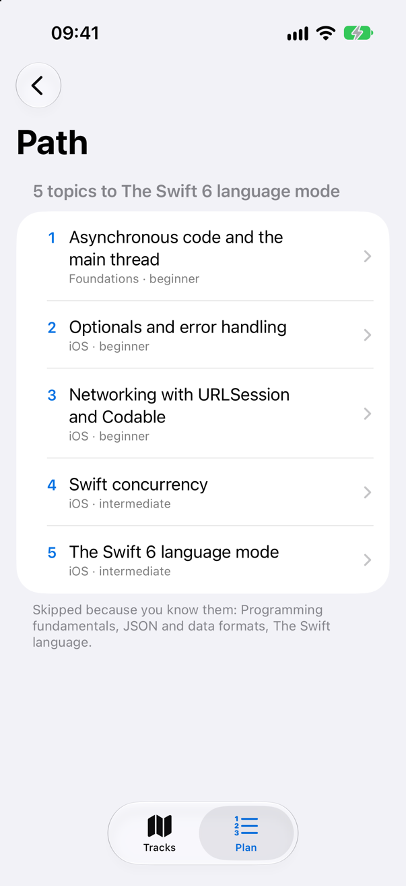

<!-- i18n-source: README.md@cccc90073ab7ae7f71e228145f72b9c22dc68449 status=reviewed -->
<!-- brand:start -->

<p align="center"><picture><source media="(prefers-color-scheme: dark)" srcset="https://raw.githubusercontent.com/muhittincamdali/mobile-developer-roadmap/main/.github/brand/banner-dark.svg"><source media="(prefers-color-scheme: light)" srcset="https://raw.githubusercontent.com/muhittincamdali/mobile-developer-roadmap/main/.github/brand/banner-light.svg"></picture></p>

<!-- lang-selector:start -->
<p align="center"><a href="README.md">English</a> · <a href="README.tr.md">Türkçe</a> · <a href="README.zh-CN.md">简体中文</a> · <a href="README.ja.md">日本語</a> · <a href="README.ko.md">한국어</a> · <a href="README.es.md">Español</a> · <a href="README.de.md">Deutsch</a> · <a href="README.fr.md">Français</a> · <a href="README.pt-BR.md">Português (Brasil)</a> · <a href="README.ru.md">Русский</a></p>
<!-- lang-selector:end -->

<p align="center">
<a href="https://github.com/muhittincamdali/mobile-developer-roadmap/actions/workflows/ci.yml"></a>
<a href="https://github.com/muhittincamdali/mobile-developer-roadmap/releases"><picture><source media="(prefers-color-scheme: dark)" srcset="https://raw.githubusercontent.com/muhittincamdali/mobile-developer-roadmap/main/.github/brand/badge-version-dark.svg"><source media="(prefers-color-scheme: light)" srcset="https://raw.githubusercontent.com/muhittincamdali/mobile-developer-roadmap/main/.github/brand/badge-version-light.svg"></picture></a>
<a href="https://github.com/muhittincamdali/mobile-developer-roadmap/blob/main/Package.swift"><picture><source media="(prefers-color-scheme: dark)" srcset="https://raw.githubusercontent.com/muhittincamdali/mobile-developer-roadmap/main/.github/brand/badge-platforms-dark.svg"><source media="(prefers-color-scheme: light)" srcset="https://raw.githubusercontent.com/muhittincamdali/mobile-developer-roadmap/main/.github/brand/badge-platforms-light.svg"></picture></a>
<a href="https://github.com/muhittincamdali/mobile-developer-roadmap/blob/main/Package.swift"><picture><source media="(prefers-color-scheme: dark)" srcset="https://raw.githubusercontent.com/muhittincamdali/mobile-developer-roadmap/main/.github/brand/badge-language-dark.svg"><source media="(prefers-color-scheme: light)" srcset="https://raw.githubusercontent.com/muhittincamdali/mobile-developer-roadmap/main/.github/brand/badge-language-light.svg"></picture></a>
<a href="https://github.com/muhittincamdali/mobile-developer-roadmap/blob/main/LICENSE"><picture><source media="(prefers-color-scheme: dark)" srcset="https://raw.githubusercontent.com/muhittincamdali/mobile-developer-roadmap/main/.github/brand/badge-license-dark.svg"><source media="(prefers-color-scheme: light)" srcset="https://raw.githubusercontent.com/muhittincamdali/mobile-developer-roadmap/main/.github/brand/badge-license-light.svg"></picture></a>
</p>

<p align="center">
<a href="#início-rápido"><picture><source media="(prefers-color-scheme: dark)" srcset="https://raw.githubusercontent.com/muhittincamdali/mobile-developer-roadmap/main/.github/brand/button-start-pt-BR-dark.svg"><source media="(prefers-color-scheme: light)" srcset="https://raw.githubusercontent.com/muhittincamdali/mobile-developer-roadmap/main/.github/brand/button-start-pt-BR-light.svg"></picture></a>
<a href="https://muhittincamdali.github.io/mobile-developer-roadmap/documentation/roadmapkit/"><picture><source media="(prefers-color-scheme: dark)" srcset="https://raw.githubusercontent.com/muhittincamdali/mobile-developer-roadmap/main/.github/brand/button-docs-pt-BR-dark.svg"><source media="(prefers-color-scheme: light)" srcset="https://raw.githubusercontent.com/muhittincamdali/mobile-developer-roadmap/main/.github/brand/button-docs-pt-BR-light.svg"></picture></a>
<a href="https://github.com/muhittincamdali/mobile-developer-roadmap/tree/main/Examples"><picture><source media="(prefers-color-scheme: dark)" srcset="https://raw.githubusercontent.com/muhittincamdali/mobile-developer-roadmap/main/.github/brand/button-examples-pt-BR-dark.svg"><source media="(prefers-color-scheme: light)" srcset="https://raw.githubusercontent.com/muhittincamdali/mobile-developer-roadmap/main/.github/brand/button-examples-pt-BR-light.svg"></picture></a>
</p>

> Esta é uma tradução do README em inglês. Se houver diferença, vale a versão em inglês.

<!-- brand:end -->

Um roteiro de aprendizado para desenvolvedores mobile: primeiro as bases comuns, depois iOS, Android, Flutter e React Native, e por fim a prática de engenharia que mantém um app funcionando depois do primeiro lançamento. São 124 tópicos. Cada um diz o que aprender, quais tópicos aprender antes, um projeto pequeno para praticar e onde aprender: apenas fontes primárias, como a documentação da Apple, do Android, do Flutter, do Dart, do React Native e do Expo, as propostas do Swift Evolution, RFCs e a OWASP. O conteúdo está atualizado para outubro de 2026: Swift 6.4 e Xcode 27, o SDK do iOS 27 com o ciclo de vida de scenes obrigatório e o Liquid Glass, Android 16, Flutter 3.47 com Dart 3.13 e React Native 0.88 com Expo SDK 58.

Você pode ler o roteiro aqui no GitHub, planejar o seu próprio caminho pelo terminal com o comando `roadmap` ou acompanhá-lo no app RoadmapExplorer para iPhone, iPad e Mac.

## Destaques

- **Um caminho, não uma lista** — cada tópico indica os tópicos de que precisa, então o `roadmap path` transforma um objetivo na lista ordenada de tópicos a aprender, pulando os que você já conhece.
- **Somente fontes primárias** — 301 links para documentação oficial e padrões. Um linter rejeita blogs, cursos e repositórios pessoais, e a verificação de links consulta cada URL toda semana.
- **Plataformas atuais** — o ciclo de vida UIScene que os apps compilados com o SDK do iOS 27 precisam adotar, o Liquid Glass (a exclusão por compatibilidade é ignorada nos builds para iOS 27), a segurança contra data races do Swift 6, as regras de tela grande do Android 16, a migração do Flutter para UIScene e a New Architecture do React Native, que é a única desde a 0.82.
- **Prática para cada tópico** — um projeto pequeno por tópico, a maioria construída sobre o mesmo app de receitas, de modo que a prática se acumula.
- **Um só formato, verificado** — os tópicos são Markdown simples com estrutura fixa, então os mesmos arquivos alimentam o GitHub, a linha de comando, o app e a biblioteca [RoadmapKit](#use-a-biblioteca); os testes falham quando falta uma dependência, surge um ciclo ou uma contagem na documentação deixa de bater.

### O que há dentro

| Trilha | Tópicos | Iniciante | Intermediário | Avançado |
| --- | ---: | ---: | ---: | ---: |
| [Fundamentos](roadmap/foundations.md) — programação, Git, HTTP, design, acessibilidade, testes, segurança | 13 | 13 | 0 | 0 |
| [iOS](roadmap/ios.md) — Swift 6, SwiftUI, scenes, Liquid Glass, SwiftData, publicação | 27 | 9 | 14 | 4 |
| [Android](roadmap/android.md) — Kotlin, Compose, corrotinas, arquitetura, interface adaptativa | 22 | 7 | 10 | 5 |
| [Flutter](roadmap/flutter.md) — Dart 3, widgets, arquitetura, testes, o lado iOS | 24 | 7 | 13 | 4 |
| [React Native](roadmap/react-native.md) — TypeScript, React, Expo Router, New Architecture, EAS | 22 | 8 | 10 | 4 |
| [Prática de engenharia](roadmap/engineering.md) — CI/CD, login, observabilidade, privacidade, segurança | 16 | 0 | 9 | 7 |

Comece pelas bases que você ainda não conhece e depois escolha uma plataforma. O formato dos arquivos está descrito em [roadmap/README.md](roadmap/README.md).

## Início rápido

**1. Obtenha o roteiro**

```sh
git clone https://github.com/muhittincamdali/mobile-developer-roadmap.git
cd mobile-developer-roadmap
```

Você precisa do Swift 6.2 ou posterior: Xcode 26 ou posterior em um Mac, ou uma [toolchain do Swift](https://www.swift.org/install/) no Linux. Para ler os arquivos Markdown, não é preciso nada.

**2. Planeje um caminho até um objetivo**

Informe o tópico que você quer alcançar e os tópicos que você já conhece:

```sh
swift run roadmap path ios/swift-6-mode --known foundations/programming,ios/swift
```

A primeira execução compila a ferramenta. Em seguida, ela mostra os tópicos na ordem em que devem ser aprendidos:

```console
$ swift run roadmap path ios/swift-6-mode --known foundations/programming,ios/swift
Path to ios/swift-6-mode: 7 topics

1. foundations/http · beginner · HTTP and web APIs
2. foundations/json · beginner · JSON and data formats
3. foundations/async · beginner · Asynchronous code and the main thread
4. ios/optionals-and-errors · beginner · Optionals and error handling
5. ios/networking · beginner · Networking with URLSession and Codable
6. ios/concurrency · intermediate · Swift concurrency
7. ios/swift-6-mode · intermediate · The Swift 6 language mode  ← goal

Skipped, already known: foundations/programming, ios/swift
```

**3. Abra o primeiro tópico**

```sh
swift run roadmap show foundations/http
```

Isso mostra o que aprender, o projeto de prática, os tópicos para os quais ele leva e seus links. Guarde os tópicos que você concluir em um arquivo de texto, um ID por linha, e pergunte o que você pode começar a seguir:

```sh
printf 'foundations/programming\nios/swift\nfoundations/http\n' > my-progress.txt
swift run roadmap next --known-file my-progress.txt --track ios
```

## Commands

| Comando | O que faz |
| --- | --- |
| `roadmap tracks` | Tópicos por trilha e nível |
| `roadmap list --track flutter --stage beginner` | Lista IDs, níveis e títulos; também aceita `--search` |
| `roadmap show react-native/new-architecture` | Um tópico com sua prática, seus pré-requisitos, os tópicos que dependem dele e seus links |
| `roadmap path <ID>... --known <IDs>` | Os tópicos em ordem para alcançar até 32 objetivos; também aceita `--known-file` |
| `roadmap next --known-file my-progress.txt` | Tópicos cujos pré-requisitos você já conhece; também aceita `--track` |
| `roadmap graph --track android` | Uma trilha como fluxograma Mermaid, que o GitHub renderiza |
| `roadmap lint` | Verifica os arquivos do roteiro; status de saída 1 em caso de qualquer problema |

Execute `swift run roadmap --help` para ver a lista completa. Entradas inválidas, como uma trilha desconhecida ou uma linha do arquivo de progresso que não é um ID de tópico, são informadas com o status de saída 2 em vez de causar uma falha; um ID bem formado que não está no roteiro, com o status de saída 1.

## Exemplo: um tópico

Cada tópico é uma seção Markdown com um ID, um nível, seus pré-requisitos, um resumo, um projeto de prática e suas fontes. Este é o `ios/app-life-cycle` em [roadmap/ios.md](roadmap/ios.md):

```markdown
## ios/app-life-cycle: The app and scene life cycle

**Stage:** beginner · **Needs:** ios/swiftui

- An app has one process and one or more scenes (windows); each scene becomes active, inactive
  and enters the background on its own.
- In SwiftUI, `App` and `WindowGroup` are scene-based, and `scenePhase` reports the changes.
- UIKit apps move from `UIApplicationDelegate` window code to `UISceneDelegate`. Apple's TN3187
  says that from the release after iOS 26, an app built with the latest SDK that does not
  adopt the scene life cycle will not launch: with Xcode 27 and the iOS 27 SDK this is required.

**Practice:** Save a draft when the scene goes to the background and restore it on the next launch.

**Learn from:**

- [TN3187: Migrating to the UIKit scene-based life cycle](https://developer.apple.com/documentation/technotes/tn3187-migrating-to-the-uikit-scene-based-life-cycle)
- [Managing your app's life cycle](https://developer.apple.com/documentation/uikit/managing-your-app-s-life-cycle)
- [ScenePhase](https://developer.apple.com/documentation/swiftui/scenephase)
```

## O app

O [RoadmapExplorer](Examples) é um app SwiftUI para iPhone, iPad e Mac construído sobre os mesmos arquivos: navegue pelas trilhas por nível, leia um tópico com seus links, marque os tópicos que você conhece e obtenha o caminho até qualquer objetivo, que pula os já conhecidos.

<p align="center">
<picture><source media="(prefers-color-scheme: dark)" srcset="docs/images/explorer-tracks-dark.png"></picture>
<picture><source media="(prefers-color-scheme: dark)" srcset="docs/images/explorer-topic-dark.png"></picture>
<picture><source media="(prefers-color-scheme: dark)" srcset="docs/images/explorer-path-dark.png"></picture>
</p>

Abra `Examples/RoadmapExplorer/RoadmapExplorer.xcodeproj` no Xcode 26 ou posterior, escolha o esquema **RoadmapExplorer** e um simulador de iPhone ou **My Mac**, e clique em **Run**. As capturas de tela são feitas a partir do app em um simulador do iOS 27 pelo script [`scripts/capture-screens.sh`](scripts/capture-screens.sh).

## Use a biblioteca

A biblioteca `RoadmapKit` lê, verifica e planeja os arquivos do roteiro a partir do seu próprio código Swift. Adicione-a com o Swift Package Manager:

```swift
dependencies: [
    .package(url: "https://github.com/muhittincamdali/mobile-developer-roadmap.git", from: "2.0.0")
],
targets: [
    .target(name: "MyLearningTool", dependencies: [
        .product(name: "RoadmapKit", package: "mobile-developer-roadmap")
    ])
]
```

```swift
import Foundation
import RoadmapKit

let roadmap = try Roadmap.load(from: URL(fileURLWithPath: "roadmap"))
let plan = try roadmap.plan(to: ["flutter/architecture"], knowing: ["foundations/programming"])
for (number, topic) in plan.steps.enumerated() {
    print(number + 1, topic.id, topic.title)
}
```

A leitura tem limites (1 MiB por arquivo, 500 tópicos por arquivo, 32 pré-requisitos e 16 links por tópico, 100 problemas informados por arquivo), e cada problema de formato volta como um `Diagnostic` com arquivo e linha, em vez de uma exceção.

## Documentação

A [documentação do RoadmapKit](https://muhittincamdali.github.io/mobile-developer-roadmap/documentation/roadmapkit/) cobre a API e três artigos:

- [Getting Started](https://muhittincamdali.github.io/mobile-developer-roadmap/documentation/roadmapkit/gettingstarted) — os comandos e como adicionar a biblioteca
- [Planning a Learning Path](https://muhittincamdali.github.io/mobile-developer-roadmap/documentation/roadmapkit/planningalearningpath) — como objetivos e tópicos conhecidos viram um caminho ordenado
- [Writing Topics](https://muhittincamdali.github.io/mobile-developer-roadmap/documentation/roadmapkit/writingtopics) — o formato dos arquivos, as regras de lint e as fontes aceitas

## Requisitos

| Uso | Requisitos |
| --- | --- |
| Ler o roteiro | Um navegador ou qualquer visualizador de Markdown |
| Comando `roadmap` | Swift 6.2 ou posterior (Xcode 26+ no macOS, ou uma toolchain do Swift no Linux) |
| Biblioteca `RoadmapKit` | Swift 6.2+, iOS 18+ ou macOS 15+ |
| App RoadmapExplorer | Xcode 26+, iOS 18+ ou macOS 15+ |

## Como contribuir

Correções, novos tópicos e fontes melhores são bem-vindos. Leia o [guia de contribuição](CONTRIBUTING.md) para saber o formato, as regras de lint e as fontes aceitas, e o [código de conduta](https://github.com/muhittincamdali/.github/blob/main/CODE_OF_CONDUCT.md) antes de abrir um pull request. Relate problemas de segurança de forma privada, como descrito na [política de segurança](SECURITY.md).

## Licença

Publicado sob a licença MIT. Veja [LICENSE](LICENSE).
